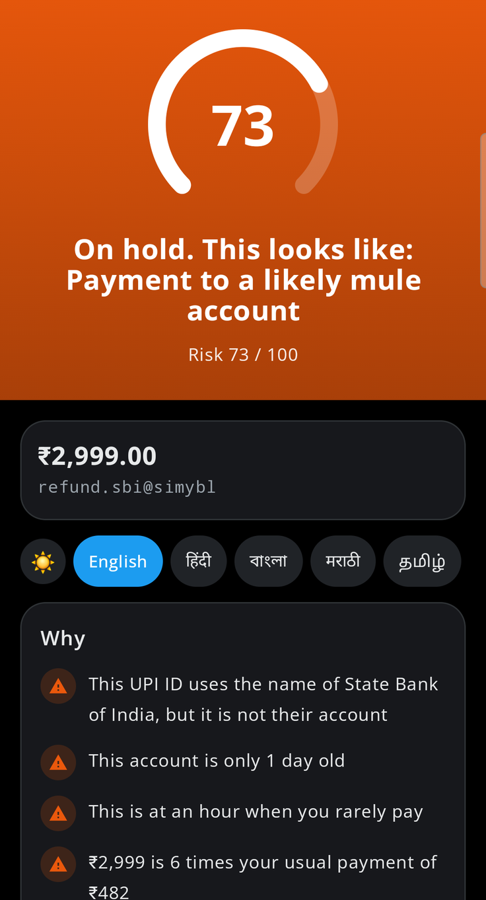
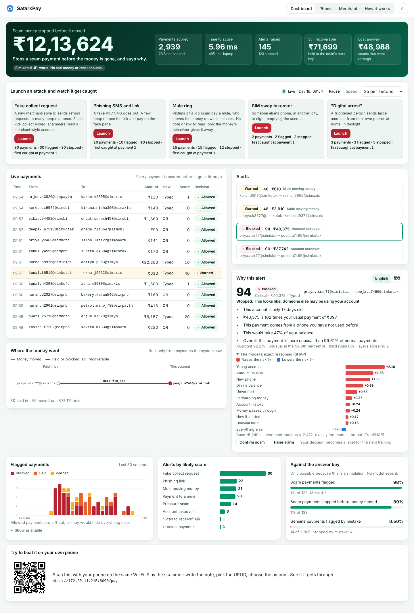

<p align="center"></p>

# SatarkPay

Stops a scam UPI payment before the money is gone, and says why.
SPHINX'26, MNIT Jaipur. Problem statement 3.2: *Real-Time Fraud Detection for UPI and Digital Payments*.

Every payment is scored before it goes through. It gets a risk score from 0 to 100, a decision (Allow, Warn, Hold or Block) and the reasons
in English, Hindi, Bengali, Marathi, Tamil or Telugu. There is a live dashboard for analysts, an alert screen for the person paying, a view for small merchants and one API call for apps.
It runs offline on one laptop, and there is a public test copy at **https://satarkpay.vercel.app**.

> **Everything here is simulated.** No real money, real accounts or real UPI connection. All UPI IDs end in `@sim...`, so that a simulated "mule" can never match a real person.
> The results are on synthetic data. **How it would do on real payments is unknown.**

<p align="center"> </p>

## Team

| Name | Role | GitHub |
|---|---|---|
| Ajay Yadav | Team leader | [@ajayyadav432](https://github.com/ajayyadav432) |
| Abhimanyu Singh Rathore | Member | [@Abhimanyu2211](https://github.com/Abhimanyu2211) |
| Harsh Verma | Member | [@haarsxh](https://github.com/haarsxh) |
| Saloni Trivedi | Member | [@SaloniTrivedi11](https://github.com/SaloniTrivedi11) |

## Try it

Open **https://satarkpay.vercel.app** and press a test login. No password is needed, and everything is simulated.

| Portal | Test login opens | Can use |
|---|---|---|
| User | `/pay` | Check and make simulated payments |
| Merchant | `/merchant` | Its own shop's payments |
| Admin | `/` | Dashboard, alerts, attacks, and the other two screens |

You can also sign up as a user or a merchant. Admin accounts cannot be created. The server checks every request, so a user who calls an admin API is refused. For a real deployment, turn test logins off with `SATARKPAY_TEST_LOGINS=0`.

**The Vercel copy is for trying it, not for the full demo.** Vercel functions restart and can run as several copies, so sign-ups, alerts and live numbers there can reset or differ between requests. The full demo runs on a laptop with `./run.sh`.

On a laptop, `./run.sh` creates passwords for the demo accounts (`sunita`, `ramesh`, `admin`) the first time and prints them once. `./run.sh accounts` makes new ones. Only salted hashes are stored, in `.env`, which is never committed.

## The phone app

Built with `cd android && ./gradlew assembleDebug`. Log in, or use a test login, then:

- **Scan UPI QR**, from the camera, a screenshot or a shared picture. It shows what the QR says, then each step of the check, then the decision and reasons in six languages.
- **Open payment app** hands a checked payment on a real UPI ID to a UPI app, and the app lists the UPI apps really installed on the phone. The person approves it there with their PIN, and SatarkPay never sees it. A blocked payment is not handed over. A warned or held one waits first.
- **Check message** and **Check link** check something pasted in.
- **Scam feed** and **History**, the same as on the website, with history saved as CSV or JSON.
- **Connection** chooses Online (the default, no cable), Laptop over Wi-Fi, or Laptop over USB cable.
- **Message protection** checks incoming SMS, with the person's permission. With notification access turned on, it also checks RCS chats, WhatsApp messages and Gmail from their notifications, and shows a score for each. Only Google Messages, Samsung Messages, WhatsApp and Gmail are read. Messages go only to the team's laptop, and never to an `https` server such as the Vercel copy. In online mode they are listed as not checked.

New to the project? Read the [Project Guide](docs/SatarkPay_Project_Guide.pdf). To test it, use the [Testing Guide](docs/SatarkPay_Testing_Guide.pdf).

## Community safety

- **Scam feed** (`/feed`): anyone can read it, and logged-in people can post, vote and comment. Real UPI IDs and phone numbers are masked, because a report is an accusation nobody has checked.
- **Reports warn, an admin blocks.** Reports from 3 different accounts add a warning to payments to that ID. Only an admin can block it, so that a group cannot get an honest shop blocked. The server enforces a block even if someone calls the API directly. A public test admin can only block simulated IDs.
- **History** (`/history`): each account sees its own payments and checks, with what was decided. Search a phone number, mail ID, UPI ID or amount, and filter by decision or type (payments, SMS, email, links). Download as CSV or JSON. The words of checked messages are not kept, only who sent them. The demo accounts also see past simulated payments, which last until the server restarts.
- **Messages from your own phone and extension** arrive without a login, so they appear for the demo accounts on the laptop or with a real password, never for a test login over Wi-Fi or for other sign-ups.
- **Sample posts:** an empty feed starts with 6 made-up posts, each marked Sample, using invented `@sim` IDs. They are not real reports.
- **Storage:** SQLite on a laptop, or Postgres when `SATARKPAY_DATABASE_URL` is set. The online copy uses a free Neon Postgres database, so its feed, reports, blocks and history survive restarts. Each public test login has its own history and cannot read anyone else's. Live dashboard numbers and simulated payments are still kept in memory, so they can reset online.
- **Translations** were written without a native speaker's review, so the wording may not be natural. A sentence with no translation stays in English.

## Try the browser extension

1. Start the app with `./run.sh`, and in a second terminal start the test site with `./run.sh demo`.
2. In Chrome, open `chrome://extensions`, turn on Developer mode, press **Load unpacked** and choose the `extension` folder.
3. Open http://127.0.0.1:8765/ and follow the page. It covers risky links, a risky page, sample emails and the switches.

## Run it

```bash
./run.sh            # start, then open http://localhost:8000
./run.sh wifi       # start so that phones on the same Wi-Fi or hotspot can join (a QR code appears on the dashboard)
./run.sh test       # run all tests
./run.sh train      # rebuild the simulated world and retrain both models
./run.sh evaluate   # measure everything again and write models/metrics.json
./run.sh paysim     # the public PaySim benchmark (downloads about 490 MB the first time)
./run.sh loadtest   # measure real latency and throughput (the app must not be running)
```

The first run builds the Python environment and needs internet once. After that, nothing needs the internet. It was built and tested with Python 3.13. Trained models are in the repo.

| Screen | For | What it does |
|---|---|---|
| `/` | Bank analyst, and the stage | Live payments, attacks to launch, alerts with reasons and SHAP, the money network, the answer key |
| `/pay` | The person paying | A demo payment app that stops the payment and says why. **Beat the model** lets you play the scammer |
| `/merchant` | A small shop | What really arrived, so a fake payment screenshot cannot fool the shopkeeper |
| `/how` | Judges | Every measured number, what each layer adds, and the known limits |

## One API call

```bash
curl -s http://localhost:8000/api/v1/score -H 'Content-Type: application/json' -d '{
  "payer": "sunita.sharma@simsbi", "payee": "refund-sbi@simybl", "amount": 2999,
  "kind": "COLLECT", "note": "Refund of Rs 2999 approve to receive"
}'
```

It returns the score, level, action, reasons in two languages, advice and the SHAP values. Nothing is recorded until `POST /api/v1/outcome`, with the `token` from that response, says what the person did. The schema is at `/openapi.json`.

## How each requirement is met

The left column is word for word from the problem statement. There is one automated test per row in `tests/test_acceptance.py`.

| # | Problem statement | How |
|---|---|---|
| R1 | "fake collect requests" | Every collect request is scored before the person approves it: the note, the payee, the blast pattern. NPCI ended P2P collect by 1 Oct 2025, so a P2P collect is a hard rule and fake collects are modelled as merchant-style accounts |
| R2 | "phishing links" | The link that opened the payment, and any scam SMS received just before, read by the context engine |
| R3 | "mule accounts" | Many strangers paying in, money going straight out, young accounts, one phone with many accounts. A live network view |
| R4 | "users only realise after money is gone" | The decision comes before money moves. If a victim pays anyway, the mule's next transfer can still be held: **₹ still recoverable** |
| R5 | "Banks, fintech apps, small merchants, consumers" | Analyst console, REST API, merchant view with a measured false-alarm rate, alert screen |
| R6 | "Train an anomaly-detection model on a synthetic or public transaction dataset" | Isolation Forest (no labels) and XGBoost on a UPI simulator, with public PaySim as a check |
| R7 | "flag risky transactions with a live scoring API" | `POST /api/v1/score` |
| R8 | "and alert screen" | `/pay` |
| R9 | "Isolation Forest or XGBoost, FastAPI, Kafka or a simple stream simulator, a dashboard" | Both models, FastAPI, a stream simulator behind a small `Bus` class, a live dashboard |
| R10 | Bonus: "Explainable alerts that tell the user why a payment looks suspicious" | Exact TreeSHAP values turned into plain sentences with real numbers, in English and Hindi. No language model, so nothing can be invented |

## How it decides

```
risk = 1 - (1 - XGBoost) x (1 - Isolation Forest) x (1 - rule 1) x (1 - rule 2) ...
```

More evidence never lowers the risk. The risk is placed on a 0 to 100 scale using bands measured on validation data: at most 1% of genuine payments reach Medium (40), 0.2% reach High (60), 0.05% reach Critical (80).

| Decision | When | Meaning |
|---|---|---|
| Allow | Below 40 | Goes through |
| Warn | 40 and up | The person sees why and can continue after a pause |
| Hold | 60 and up, ₹200 or more | Paused for a cooling-off, in the analyst queue |
| Block | 80 and up, and two independent layers agree or a plain fact applies | Refused, with the reason and a way to appeal |

A model alone can never refuse a payment. The rules are in `app/payments/policy.py`.

## Measured results

Every number is written by `ml/evaluate.py`, `ml/paysim_benchmark.py` or `scripts/loadtest.py` to `models/metrics.json`, and the `/how` page reads that file. Test data is later in time than training data, and test scammers are accounts never seen in training. It covers 3,87,688 payments with 2,434 scams, including a whole new world that nothing was tuned on.

We never report accuracy. Reported UPI fraud is about 6.8 per million payments, so a model that never flags anything is 99.999% "accurate".

**The policy on the test set.** Scam payments flagged: **93%**. Stopped before the money moved: **84%**. Genuine payments flagged: **0.59%**. Stopped: **0.04%**. Obvious scams flagged: 99%. Careful scams, which try to look normal: 80%.

| Scam | In test | Flagged | Stopped |
|---|---|---|---|
| Fake collect request | 562 | 100% | 98% |
| Phishing link | 257 | 96% | 69% |
| "Scan to receive" QR | 96 | 77% | 66% |
| Payment to a mule | 374 | 94% | 83% |
| Mule moving money on | 996 | 91% | 83% |
| Account takeover | 63 | 89% | 63% |
| "Digital arrest" transfer | 86 | 87% | 73% |

**What each layer adds.** Recall is at the same budget, 1% of genuine payments flagged.

| Layers | PR-AUC | Recall |
|---|---|---|
| Payer behaviour only | 0.496 | 56% |
| + the account's own money moves | 0.516 | 58% |
| + payee signals (mules) | 0.898 | 95% |
| + Context engine (note, link, UPI ID, SMS) | 0.940 | 97% |
| + Isolation Forest and hard rules (the full system) | 0.931 | 95% |
| Isolation Forest alone (no labels at all) | 0.209 | 39% |

On scams it has seen, XGBoost alone does slightly better than the full system. The other layers earn their place in the next test.

**Scams it has never seen.** Train with no example of one scam type, then see what still catches it, at the same budget.

| Left out of training | XGBoost alone | Full system |
|---|---|---|
| Fake collect request | 7% | 81% |
| Phishing link | 37% | 73% |
| "Scan to receive" QR | 27% | 66% |
| Payment to a mule | 84% | 83% |
| Mule moving money on | 79% | 73% |
| Account takeover | 59% | 81% |
| "Digital arrest" transfer | 94% | 90% |

**If scammers get smarter.** In a separate world where 90% of scams are careful, with no retraining: 76% flagged, 61% stopped, 0.63% of genuine payments flagged.

**Public data.** On PaySim, split by time, XGBoost scores PR-AUC 0.998 with the balance columns and 0.697 without. In 97.8% of PaySim's fraud rows the amount equals the sender's whole balance, against 0.0001% of genuine rows, so the first number mostly finds that shortcut. The number to trust is the second.

**Speed on this laptop.** One server process: p50 2.27 ms, p95 5.06 ms, p99 6.98 ms over HTTP, 483 requests per second with 4 clients at once.

## Known limits

- **Everything is synthetic.** Accuracy on real payments is unknown. We wrote the simulator, so the model may have learned the simulator. Hard cases, new worlds and leave-one-out tests reduce that risk. They do not remove it.
- **Precision here is flattering.** The simulation has about 923 times more fraud than reported reality, so that the model has examples. If real fraud is that rare and the model were this good, which is unproven, there would be about 929 false alarms per real scam at this budget. A bank would set a much tighter budget. The design assumes this: warnings are cheap, blocks are rare, and a person always has a way out.
- **Payee signals need a view across banks.** A single bank cannot see fan-in on another bank's account. That points to a deployment at the network level.
- **No real UPI integration.** A hackathon cannot get one. The integration point is one API call before the payment is sent.
- **Kafka is not built.** The problem statement allows a stream simulator, and a stream simulator keeps the demo on one laptop with nothing else to install. The `Bus` class is where Kafka would go. That has not been tested.
- **Logins are demo accounts.** There is one account per role, no sign-up, and logins end when the server restarts. It runs over plain http on one local network. A real deployment needs real accounts, https and rate limits on the API.
- **SMS privacy.** In this demo the laptop reads the SMS. The production design scores it on the phone and sends only the score.
- **The Android app has been run on one real phone (Samsung SM-E366B, Android 17).** QR pictures, the check, logins and the result screens were tested on it (`android/app/src/androidTest`). The camera was shown to open. Reading a QR through the lens, a real incoming SMS, a real WhatsApp notification and a real payment through a UPI app have not been confirmed. Real RCS messages from another phone were read and scored on it. UPI apps may also refuse a request from another app, whatever we send.
- **Sign-ups use a shared simulated wallet.** A new user pays as a demo person and a new merchant sees the demo shop, because real accounts are not connected.
- **The "this looks like" label is a best guess.** It named the right scam for 80% of flagged scams in the test. The reasons are exact. The label is not.

## QR results

The results above do not cover QR scans, so QR contents are measured on their own (`python -m ml.qr_eval`, results in `models/qr_metrics.json`). The set is 20 scam and 20 safe QR contents written by hand and fixed before the first run. Nothing was tuned on it.

| | Result |
|---|---|
| Scam QRs flagged | 13 of 20 |
| Scam QRs stopped (Hold or Block) | 7 of 20 |
| Safe QRs flagged | 1 of 20 |
| Safe QRs stopped | 0 of 20 |

This is small, it is hand-written, and it tests what a QR says, not reading one through a camera. It is weaker than the main results. Misses include prize and lottery notes, a threat about a power cut, and plain payments with no words at all.

## Project layout

```
app/
  main.py            REST API, live stream, pages
  config.py          names, paths, limits
  payments/          features, context, rules, models, policy, explain, scorer, live, scenarios, graph, store
  analysis/, data/   the context engine and rules
  static/            dashboard, pay, merchant, how
ml/
  simulate.py        the UPI world: normal life, 7 scam types, hard cases
  dataset.py         replays a world through the live feature store
  train.py           XGBoost, Isolation Forest, score bands
  evaluate.py        everything on the model card
  paysim_benchmark.py
  engine/            the engine's trained text and URL models
models/              xgb.ubj, iforest.joblib, bundle.json, metrics.json
tests/               unit, parity, API, security, acceptance R1-R10, browser; engine/ holds the engine's own tests
android/             the phone app: scans UPI QR codes and checks SMS
extension/           SatarkPay Link Guard
docs/                demo script, judging Q&A, pitch deck
```

## Using the phone app and extension

- **Phone app (Android): scan a UPI QR.** Build with `cd android && ./gradlew assembleDebug`. Connect by USB and run `./run.sh phone` in a second terminal, or use `./run.sh wifi` and enter `http://<laptop-ip>:8000` under *Laptop connection*. Press *Scan UPI QR* and point it at a code on `http://localhost:8000/qr`, or share a QR picture to the app. It checks the payment and shows the decision and reasons. It never moves real money. A real UPI ID has no history in this system, so only its ID, amount and note are checked, and the app says so.
- **Phone app (Android): SMS.** Enter the printed pairing code under *Laptop connection* and allow SMS. A real SMS then becomes context: a payment that follows it is scored with it.
- **Phone app (Android): RCS, WhatsApp and Gmail.** Under *Laptop connection*, press *Check RCS, WhatsApp and Gmail too* and allow notification access for SatarkPay. Android gives apps no other way to see these messages. Only what the notification shows is read, so a muted chat is not checked, and for Gmail only the sender, subject and preview are read, not the whole e-mail or its links. A message seen both as an SMS and as a notification counts once. Messages still in the notification shade when access is turned on are checked too, up to 24 hours old.
- **Link Guard (Chrome or Edge).** Load `extension/` at `chrome://extensions` with *Developer mode* on. It marks risky links on any page and shows a warning before they open. The server must be running on this laptop.

## Data sources and facts

- **The UPI world:** written by the team (`ml/simulate.py`). Same seed, same data. Not stored in the repo.
- **PaySim:** Lopez-Rojas, Elmir, Axelsson (2016), downloaded from the Hugging Face mirror `theman10/paysim`. Not stored in the repo.
- **The engine's text and URL models:** SMS Spam Collection, UCI ML Repository (228), CC BY 4.0. Phishing Email Dataset, Hugging Face `zefang-liu/phishing-email-dataset`, LGPL-3.0. PhiUSIIL Phishing URL Dataset, UCI ML Repository (967), CC BY 4.0. Web page phishing URL dataset, Hugging Face `pirocheto/phishing-url`, CC BY 4.0.
- **Facts quoted in the app and the pitch:** [NPCI ends P2P collect](https://www.angelone.in/news/market-updates/npci-to-end-upi-person-to-person-collect-requests-from-october-to-curb-fraud), [UPI fraud figures, Lok Sabha, 15 Dec 2025](https://ianslive.in/upi-frauds-worth-rs-805-crore-witnessed-this-fiscal-so-far-minister--20251215175703), [UPI volume in FY25](https://www.business-standard.com/finance/news/upi-s-contribution-to-payments-ecosystem-volume-grows-to-83-4-in-fy25-125052900871_1.html), [Financial Fraud Risk Indicator](https://www.medianama.com/2025/05/223-dot-financial-fraud-risk-indicator-upi/). These are press-reported.
- **Open Sans font:** SIL Open Font License, `app/static/vendor/fonts/OPEN-SANS-LICENSE.txt`.
- **Twitter colour theme:** values from [tweakcn](https://tweakcn.com/r/themes/twitter.json), copied by hand into the website, extension and app.
